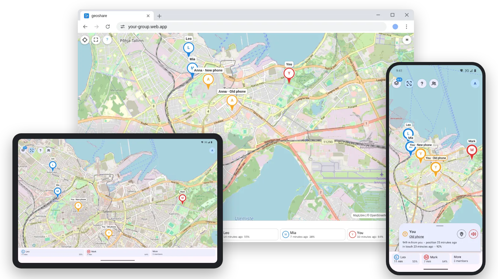

# geoshare

[English](README.md) · Русский

<picture>
  <source media="(prefers-color-scheme: dark)" srcset="docs/images/hero-dark.webp">
  
</picture>

Обмен местоположением внутри группы, например семьи, на устройствах Android и в
браузере. Участники входят обычными аккаунтами Google, а всё работает на
бесплатном тарифе Firebase.

Устройство каждого участника сообщает, где оно находится, а те, кому участник
открыл доступ, видят его на карте — в приложении Android или на веб-странице:
насколько свежа позиция, какова её точность и сколько заряда осталось у
устройства. Своего сервера нет, ни запускать, ни оплачивать нечего: устройства и
страница обращаются к Cloud Firestore напрямую, а весь серверный код — это
правила безопасности. Данные каждой группы хранятся в её собственном проекте
Firebase.

Ответы на частые вопросы — в [FAQ.ru.md](FAQ.ru.md).

## Содержание

- [Что умеет](#что-умеет)
- [Как начать](#как-начать)
- [Приватность](#приватность)
- [Лимиты бесплатного тарифа](#лимиты-бесплатного-тарифа)
- [Ложные позиции](#ложные-позиции)
- [Разработка](#разработка)
- [Лицензия](#лицензия)

## Что умеет

- **Карта группы.** На каждое устройство один маркер с лицом и именем
  участника; стоящих рядом карта объединяет в один маркер, пока её не
  приблизят. Под картой — полоса со всеми участниками, по нажатию открывается
  карточка: возраст позиции, когда устройство последний раз выходило на связь,
  заряд, режим сбора и расстояние до вас.
- **Слежение.** Карта может держать в центре одного участника, показывать всех
  сразу или оставаться там, куда её сдвинули; режим выбирается в меню над
  картой.
- **Доступ каждому отдельно и до срока.** Участник сам выбирает, кому и до
  какого времени показывать себя; отозванный доступ закрывается сразу, а не
  когда устройство в следующий раз запишет позицию.
- **Вступление по ссылке.** Администратор делает приглашение на один адрес
  Google и отправляет ссылку подключения или показывает её QR-кодом. Ссылка
  направляет устройство в проект группы и впускает эту учётную запись один раз
  в течение суток.
- **Управление группой.** Администратор раздаёт приглашения, исключает
  участников, назначает других администраторов и видит, на связи ли каждое
  устройство, — но не видит, кто кому открыл доступ и кто где находится.
- **Поиск участника.** Если с человеком нет связи, администратор открывает его
  место всей группе на шесть часов, сутки или трое суток. На картах у всех он
  обведён красным, а его устройство сообщает о поиске уведомлением, которое
  завершает поиск одним нажатием.
- **Сирена на потерянном устройстве.** Участник может включить звук на своём
  устройстве, администратор — на любом устройстве группы: 22 секунды на полной
  громкости через канал будильника, в обход режима «Не беспокоить».
- **Несколько групп на одном устройстве.** Устройство может состоять в
  нескольких группах, у каждой свой проект Firebase; карта показывает одну
  группу за раз, а позиция уходит во все группы, каждой — со своим списком
  тех, кому она видна.
- **Свои имена.** Каждый может назвать чужие устройства и людей как ему
  удобно — эти имена видит только он.
- **Две темы и два языка.** Светлая, тёмная или как в системе, на русском или
  английском — одинаково на устройстве и на странице.

## Как начать

### Завести группу

Тому, кто заводит группу, — владельцу проекта — нужны учётная запись Google с
включённой двухэтапной проверкой (консоль Firebase требует её с 18 октября
2026 года) и браузер, терминал не нужен:

1. Открыть страницу настройки [geoshare-setup.web.app](https://geoshare-setup.web.app/).
   Её первый шаг отправит в [консоль Firebase](https://console.firebase.google.com/)
   создать проект и подскажет, что там выбрать: бесплатного тарифа Spark
   достаточно, Google Analytics можно выключить.
2. Вернувшись на страницу настройки, войти и выбрать проект. Страница создаст
   базу, правила, приложения для Android и веба и собственный сайт группы, а
   два шага, которые делаются только в консоли, проведёт по порядку
   ([docs/console-steps.ru.md](docs/console-steps.ru.md)).
3. В конце страница выдаёт ссылку подключения и её QR-код.

Владелец проекта видит из консоли Firebase места и историю всех участников, в
обход правил; приложение говорит об этом каждому до вступления.

То же самое из терминала делает [tools/project.sh](tools/project.sh) — на
машине с Node.js 20 или новее; описание в
[docs/new-project.md](docs/new-project.md).

### Вступить в группу

1. Скачать приложение со [страницы релизов](https://github.com/VitalyOstanin/geoshare/releases)
   и установить. Нужен Android 8 или новее; сервисы Google Play не требуются.
2. Открыть ссылку подключения из приглашения или отсканировать её QR-код на
   экране подключения в приложении.
3. Войти через Google с тем адресом, на который сделано приглашение. В первый
   раз Google спросит, можно ли адресу группы (`<project>.firebaseapp.com`)
   узнать ваш адрес почты; это адрес самой группы, разрешите.

## Приватность

- Данные группы лежат в проекте Firebase владельца проекта и больше нигде; у
  geoshare нет своего сервера и нет аналитики.
- Членство в группе показывает участнику, кто ещё в ней состоит, но не где они:
  каждый сам называет тех, кто может его видеть, поимённо и каждому до
  выбранного срока.
- Правила читают этот доступ оттуда, где его записывает сам участник, поэтому
  отзыв закрывает позицию сразу — даже для выключенного устройства.
- Участник пишет только свои документы; подделать чужую позицию нельзя.
- Приглашение не может прочитать никто, включая создавшего его
  администратора; оно впускает только ту учётную запись Google, для которой
  сделано, один раз и не дольше суток.
- Владелец проекта читает всё из консоли Firebase в обход правил: заводить
  проект должен тот, кому группа это доверяет.
- Модель документов и обоснование каждого правила — в
  [firebase/data-model.md](firebase/data-model.md); соответствие правил ей
  проверяется тестами на эмуляторе Firestore.

## Лимиты бесплатного тарифа

У бесплатного тарифа Spark суточные лимиты: 50 000 чтений документов, 20 000
записей и 20 000 удалений, а также 1 ГиБ данных ([квоты
Firestore](https://firebase.google.com/docs/firestore/quotas)). Семья с двумя
устройствами, которая иногда открывает страницу, расходует за сутки около 5%
чтений и записей. После превышения база перестаёт отвечать до сброса квоты
около полуночи по тихоокеанскому времени, поэтому владельцу проекта стоит
следить за расходом — в консоли Firebase или командой `tools/project.sh show
<project-id> --usage`.

## Ложные позиции

Спутниковому приёмнику можно подсунуть ложный сигнал, и устройство под ним
уверенно сообщает место, где его нет. Приложение взвешивает каждый ответ
перед записью: скачки, которые не совершить ни на каком транспорте, ответы,
описывающие круг вокруг передатчика, спутники, время которых расходится со
временем устройства, спутниковое решение далеко от того, что говорят вышки и
Wi-Fi, и места, которые группа отметила как известные ложные. Позиция, которой
нет доверия, не записывается, и карточка объясняет почему; устройство под
передатчиком всё равно сообщает, что оно на связи и сколько у него заряда.

Известные ложные места группы записывает владелец проекта в консоли Firebase,
как описано в [docs/false-places.ru.md](docs/false-places.ru.md); экрана для
этого пока нет.

## Разработка

Как всё устроено внутри, режимы сбора, сборка, тесты и устройство репозитория
описаны в [docs/development.md](docs/development.md) (на английском).

## Лицензия

MIT, см. [LICENSE](LICENSE). Это лицензия собственного кода репозитория;
включённые в него части сохраняют свои:

- библиотеки приложения перечислены вместе с лицензиями на его экране
  лицензий открытого ПО в настройках;
- страница несёт копии Firebase (Apache-2.0), MapLibre GL JS (BSD-3-Clause)
  и qr (MIT или Apache-2.0) в `web/public/lib/vendor/`, у каждой рядом её лицензия;
- карта строится по данным OpenStreetMap, © участники OpenStreetMap, под
  [ODbL](https://www.openstreetmap.org/copyright); указание авторства есть
  на самой карте.
