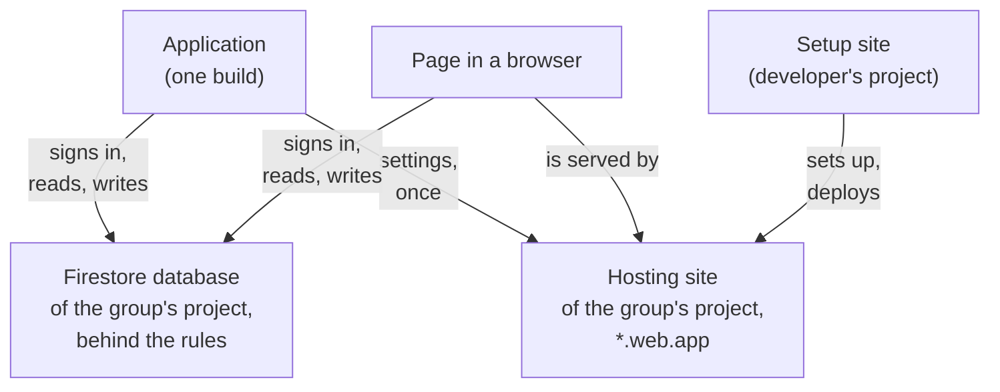
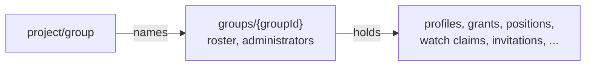

# Architecture

How geoshare is put together above the level of the code: whose accounts and
projects there are, what runs where, what a group is in relation to them, and
what each of them costs. The documents in the database are described in
[GLOSSARY.md](../GLOSSARY.md#entities-and-relations) and
[firebase/data-model.md](../firebase/data-model.md); the reasons for each
choice are in [the decision records](ADR/README.md).

## Contents

- [The parts](#the-parts)
- [How they relate](#how-they-relate)
- [A project and its group](#a-project-and-its-group)
- [How a device finds its project](#how-a-device-finds-its-project)
- [The clients](#the-clients)
- [What a project gets for free](#what-a-project-gets-for-free)
- [What lives outside the project](#what-lives-outside-the-project)

## The parts

| №   | Part            | What it is                                                                                                                                        | Decided in         |
|-----|-----------------|---------------------------------------------------------------------------------------------------------------------------------------------------|--------------------|
| 1   | Project owner   | The person whose Google account owns a group's Firebase project. Can read everything in it from the console, and is one of the group              | ADR-0005           |
| 2   | Group's project | A Firebase project on the free Spark plan: Google sign-in, one Firestore database, one Hosting site. Holds one group and nothing else             | ADR-0005, ADR-0036 |
| 3   | Group's site    | `https://<site>.web.app`, the Hosting site named after the project. Serves the page, the join page and the settings a device starts Firebase with | ADR-0001, ADR-0033 |
| 4   | Group           | `groups/{groupId}` in the project's database: the roster, the administrators and everything the members publish, underneath it                    | ADR-0009, ADR-0036 |
| 5   | Project's mark  | `project/group`: the id of the one group the project holds, written once together with it                                                         | ADR-0036           |
| 6   | Member          | A Google account on the group's roster                                                                                                            | ADR-0002           |
| 7   | Device          | A phone or tablet with the application, or a browser with the page open. One member may have several; one device may be in several groups         | ADR-0007, ADR-0026 |
| 8   | Application     | One Android build for every group, carrying no project; it learns each project from a connection link                                             | ADR-0001           |
| 9   | Page            | The web client on the group's site: the map, the roster, the administrator's panel. It talks only to the project it is served from                | ADR-0004           |
| 10  | Setup site      | A Hosting site of the developer's own project with the setup page, which finishes a new group's project for its project owner                     | ADR-0033           |

## How they relate

Every arrow into the database passes the rules in
[firebase/firestore.rules](../firebase/firestore.rules); there is no server of
the project's own between a client and its data.

Inside the database, the project's mark names the one group, and everything
the members publish lives under the group document:

## A project and its group

A project holds one group (ADR-0036). The group is founded once, by the
project owner (ADR-0038): the rules, as deployed, accept the founding only
from the verified address of the owner's Google account. It is written in a
batch that also writes `project/group`; the rules refuse a second founding, and refuse any change to the mark or its deletion from a
client. A device signed in to a project whose group it is not in reads the mark
and is offered only joining by an invitation.

| №   | Wanted                                     | How                                                                                    |
|-----|--------------------------------------------|----------------------------------------------------------------------------------------|
| 1   | More people in a group                     | Invitations from an administrator, up to 50 members (ADR-0015, ADR-0025)               |
| 2   | A second group, of the same account or not | A second project, set up the same way as the first (ADR-0033); its own site and link   |
| 3   | One person in two groups                   | One device joins both: each group is a connection with its own Firebase app (ADR-0026) |
| 4   | A fresh start for a group                  | A new project: groups are never deleted, and an abandoned one keeps its project        |

So the project is what separates groups: their data, their rules deployment,
their site and their free quotas are never shared. A group whose project was
set up before 2026-10-13 gets its mark written once by hand
([ADR-0036](ADR/0036-a-project-holds-one-group.md)).

## How a device finds its project

1. The project owner finishes the project on the setup page, or with
   `tools/project.sh`, and gets the connection link
   `https://<site>.web.app/join` with its QR code
   ([new-project.md](new-project.md)).
2. The link, or an invitation built on it (ADR-0017), opens the join page on
   the group's site; the page hands it to the application.
3. The application reads `https://<site>.web.app/geoshare.json` — the
   project id, the application id, the API key, the sender id and the site —
   keeps it, and starts a Firebase app with it. None of these values is a
   secret: the rules guard the data.
4. The device signs in with Google, then reads the mark and the group, and
   either joins by the invitation or, in an empty project, offers to found
   the group; the rules let only the project owner do it.

The page needs no such step: it is served by the site of its project, beside a
`firebase-config.js` written when the site was deployed.

## The clients

| №   | Client      | Built from                          | Talks to                                    | Notes                                                                     |
|-----|-------------|-------------------------------------|---------------------------------------------|---------------------------------------------------------------------------|
| 1   | Application | `android/`, Kotlin and Compose      | its projects; GitHub, for updates           | publishes positions; collection modes keep the writes within the quota    |
| 2   | Page        | `web/public/`, JavaScript, no build | the project whose site serves it            | watches and administers; publishes no position                            |
| 3   | Setup page  | `web/public/setup.html`             | the Google APIs of the project being set up | runs with the project owner's own token, on the setup site                |
| 4   | Rules       | `firebase/firestore.rules`          | —                                           | the only guard of the data; deployed to each project by its project owner |

## What a project gets for free

Every limit of the Spark plan is per project, not per account or per
application
([Firebase pricing](https://firebase.google.com/pricing), checked on
2026-10-13), so each group has the whole of it.

| №   | Service        | Free limit                                     | What spends it here                                               |
|-----|----------------|------------------------------------------------|-------------------------------------------------------------------|
| 1   | Firestore      | 50,000 document reads a day                    | subscriptions of open maps, the start of each client              |
| 2   | Firestore      | 20,000 writes and 20,000 deletes a day         | positions and watch claims, by collection mode (ADR-0010)         |
| 3   | Firestore      | 1 GiB stored, 10 GiB of network egress a month | one position per device, overwritten rather than added (ADR-0007) |
| 4   | Hosting        | 10 GB stored, 360 MB of transfer a day         | the page and its libraries, loaded by browsers                    |
| 5   | Authentication | 50,000 monthly active users                    | one per member                                                    |

The daily quotas reset at midnight Pacific time; `tools/project.sh show
--usage` prints how much of them the project has spent. A project on the free
plan stops at a limit instead of being billed, which is why it is never moved
to the Blaze plan ([console-steps.md](console-steps.md)).

A Google account on the free plan can create only a few projects, usually
around five to ten
([Firebase projects](https://firebase.google.com/docs/projects/learn-more),
checked on 2026-10-13); more are asked of Google Cloud. Deleted projects count
against it for 30 days.

## What lives outside the project

| №   | Service                    | Used for                                            | What it learns                                        |
|-----|----------------------------|-----------------------------------------------------|-------------------------------------------------------|
| 1   | OpenStreetMap tile servers | the map's raster tiles (ADR-0006)                   | which tiles a client draws, so roughly where it looks |
| 2   | Google sign-in             | the members' accounts (ADR-0002)                    | that the account signed in to this project            |
| 3   | Orbit files                | holding the sky against published orbits (ADR-0023) | that the device downloaded them                       |
| 4   | GitHub Releases            | the daily update check, the package, checksums      | device address; that it checked or downloaded         |
